# Planejamento e Análise de Valor Agregado (EVM)
- Carlos Augusto Bertão Rodrigues
- Eduardo de Mendonça Freire
- João Pedro Peçanha Cotrim
- Marco Antonio Tronco Felix

## 1. Descrição do Escopo

### Objetivo
Desenvolver e implantar um aplicativo completo para automatizar a coleta de disponibilidade e a geração das escalas (mensal, bimestral ou trimestral) dos professores voluntários do ministério infantil da igreja, substituindo o processo manual feito atualmente pela líder Débora no WhatsApp.

### Entregáveis Principais (Dentro do Escopo)
- **Autenticação e Perfis de Acesso:** Cadastro e login com distinção entre Administradora (adm) e Voluntários.
- **Gestão de Enquetes e Prazos:** Criação de enquetes por data/ocasião (domingo de manhã, domingo à noite e quinta-feira à noite), definição de abrangência (mensal, bimestral ou trimestral), prorrogação de prazo e monitoramento de respostas.
- **Motor de Montagem de Escala:** Algoritmo que gera a escala automaticamente ou sob comando da adm, alocando professor principal, auxiliar e instrumentista de acordo com as restrições de aptidão por classe/função, acúmulo permitido de funções, limite máximo de atuações no período e ranking de prioridade (visível apenas para a adm).
- **Revisão, Edição Manual e Lacunas:** Aprovação obrigatória pela adm antes da divulgação, suporte a vagas preenchidas com *"a definir"*, edição manual com quebra temporária de restrições/ranking, inserção de nomes não cadastrados e campo de link do Google Drive para o material das aulas.
- **Divulgação e Notificações:** Envio da escala (com os links do Google Drive) e notificações (app, e-mail ou WhatsApp) na abertura da enquete e uma semana antes da atividade.

### Exclusões (Fora do Escopo)
- Encomenda ou gestão automática de revistas de lições junto à editora (*Won't have*).
- Controle financeiro da igreja, gestão de frequência dos alunos ou cadastro de crianças e responsáveis.

### Premissas e Restrições
- **Premissa:** A igreja e os voluntários adotarão o aplicativo de forma padronizada, substituindo as enquetes manuais no WhatsApp.
- **Premissa:** A equipe é formada pelos quatro integrantes do grupo, com dedicação de no máximo cerca de 20 h/semana por pessoa (nivelamento de recursos da seção 5).
- **Premissa:** A Débora (líder) e os voluntários são **partes interessadas e usuários**, não membros da equipe. Participam apenas de validações pontuais (requisitos, protótipos e teste piloto), e esse tempo **não é custeado** no BAC.
- **Restrição:** Operação com baixo custo de infraestrutura (priorizando camadas gratuitas ou de baixo custo) e interface simples para usuários não técnicos.

### Coerência com a priorização MoSCoW
A edição manual da escala aparece como *Could have* em "Desejos das Partes Interessadas", mas a "Descrição Informal" a trata como requisito (preencher funções "a definir", quebrar restrições e inserir nomes não cadastrados). Por isso ela **entra no escopo** (atividade F). Na execução, os itens *Must have* (publicar enquete, montar escala, enviar escala com link) têm prioridade, e os itens *Should/Could have* (notificações, prorrogação de prazo, edição avançada) são os primeiros candidatos a corte em caso de atraso.

---

## 2. Estrutura Analítica do Projeto (EAP)

A letra entre colchetes indica a atividade da seção 3 que executa cada pacote de trabalho.

```text
1. Sistema de Gestão de Escala do Ministério Infantil
├── 1.1 Iniciação e Engenharia de Requisitos
│   ├── 1.1.1 Levantamento do problema e análise de valor (B2B)                      [A]
│   ├── 1.1.2 Especificação de requisitos (MoSCoW) e Histórias de Usuário            [A]
│   └── 1.1.3 Prototipação de interfaces (UI/UX - Fluxos Adm e Voluntário)           [B]
├── 1.2 Arquitetura e Infraestrutura
│   ├── 1.2.1 Modelagem do banco de dados (usuários, classes, funções, escalas)      [C]
│   └── 1.2.2 Configuração de ambiente, repositórios e solicitação das APIs          [C]
├── 1.3 Desenvolvimento do Backend e Motor de Escala
│   ├── 1.3.1 Módulo de autenticação, perfis e permissões (Adm vs. Voluntário)       [D]
│   ├── 1.3.2 Módulo de enquetes, prazos, prorrogação e painel de respostas          [D]
│   ├── 1.3.3 Algoritmo de geração de escala (restrições, ranking e teto mensal)     [E]
│   └── 1.3.4 Módulo de edição manual, vagas "a definir" e links do Google Drive     [F]
├── 1.4 Desenvolvimento do Frontend (Aplicativo)
│   ├── 1.4.1 Telas do Voluntário (login, resposta de enquete, visualização)         [G]
│   └── 1.4.2 Telas da Administradora (regras/ranking, aprovação e ajustes manuais)  [H]
├── 1.5 Integração de Notificações e Qualidade (QA)
│   ├── 1.5.1 Implementação de alertas (abertura de enquete e lembrete de 7 dias)    [I]
│   └── 1.5.2 Testes integrados, validação de cenários extremos e correção de bugs   [J]
└── 1.6 Implantação e Encerramento
    ├── 1.6.1 Deploy em produção e teste piloto com a líder Débora e voluntários     [K]
    └── 1.6.2 Documentação final, manual de uso e entrega da disciplina              [K]
```

---

## 3. Diagrama de Redes e Tabela de Precedências

### Tabela de Atividades e Dependências

| ID | Atividade | Duração (Semanas) | Predecessora(s) |
| :--- | :--- | :---: | :---: |
| **A** | Especificação de requisitos, MoSCoW e Histórias de Usuário | 1 | — |
| **B** | Prototipação de UI/UX (Fluxos Adm e Voluntário) | 1 | A |
| **C** | Modelagem do Banco de Dados, Arquitetura e Ambiente | 1 | A |
| **D** | Backend: Usuários, Perfis, Enquetes e Prazos | 2 | C |
| **E** | Backend: Motor/Algoritmo de Montagem de Escala | 3 | C |
| **F** | Backend: Edição Manual, vagas "a definir" e Links do Drive | 1 | D |
| **G** | Frontend: Telas do Voluntário | 2 | B, D |
| **H** | Frontend: Telas de Gestão e Edição Manual (Adm) | 2 | B, E, F |
| **I** | Integração de Notificações (App/E-mail/WhatsApp) e envio da escala | 2 | D, E, F |
| **J** | Testes Integrados, Validação de Regras e Correção de Bugs (QA) | 2 | G, H, I |
| **K** | Deploy, Teste Piloto com a Débora, Documentação e Entrega Final | 1 | J |

Observação: a atividade F usa a estrutura de usuários e permissões de D e trabalha sobre o modelo de dados da escala definido em C (entidade Escala com status "a definir" e campo de link). A integração com o motor (E) é validada em J.

### Diagrama de Redes



### Análise do Caminho Crítico (CPM)

| ID | Duração | Início | Fim | Folga (semanas) |
| :--- | :---: | :---: | :---: | :---: |
| **A** | 1 | S1 | S1 | 0 |
| **B** | 1 | S2 | S2 | 2 |
| **C** | 1 | S2 | S2 | 0 |
| **D** | 2 | S3 | S4 | 0 |
| **E** | 3 | S3 | S5 | 0 |
| **F** | 1 | S5 | S5 | 0 |
| **G** | 2 | S5 | S6 | 1 |
| **H** | 2 | S6 | S7 | 0 |
| **I** | 2 | S6 | S7 | 0 |
| **J** | 2 | S8 | S9 | 0 |
| **K** | 1 | S10 | S10 | 0 |

- **Caminhos Críticos:**
  - `A -> C -> E -> H -> J -> K`
  - `A -> C -> E -> I -> J -> K`
  - `A -> C -> D -> F -> H -> J -> K`
  - `A -> C -> D -> F -> I -> J -> K`
- **Duração Total Estimada:** 1 + 1 + 3 + 2 + 2 + 1 = **10 semanas** (cerca de 2,5 meses). O caminho via D e F também soma 1 + 1 + 2 + 1 + 2 + 2 + 1 = 10 semanas.
- **Atividades com folga:** B (2 semanas) e G (1 semana).

---

## 4. Cronograma (Baseline - 10 Semanas)

| ID | Atividade | S1 | S2 | S3 | S4 | S5 | S6 | S7 | S8 | S9 | S10 |
| :--- | :--- | :-: | :-: | :-: | :-: | :-: | :-: | :-: | :-: | :-: | :-: |
| **A** | Especificação de Requisitos e Histórias | X | | | | | | | | | |
| **B** | Prototipação UI/UX | | X | | | | | | | | |
| **C** | Modelagem BD, Arquitetura e Ambiente | | X | | | | | | | | |
| **D** | Backend: Usuários, Enquetes e Prazos | | | X | X | | | | | | |
| **E** | Backend: Motor de Escala | | | X | X | X | | | | | |
| **F** | Backend: Edição Manual, "a definir" e Drive | | | | | X | | | | | |
| **G** | Frontend: Telas do Voluntário | | | | | X | X | | | | |
| **H** | Frontend: Telas da Administradora | | | | | | X | X | | | |
| **I** | Integração de Notificações | | | | | | X | X | | | |
| **J** | Testes Integrados e QA | | | | | | | | X | X | |
| **K** | Deploy, Teste Piloto e Encerramento | | | | | | | | | | X |

---

## 5. Recursos Necessários por Atividade

### Papéis da Equipe
- **Product Owner / Analista de Requisitos / QA (Carlos Augusto):** Levantamento das regras com a Débora, priorização MoSCoW, regras de negócio da edição manual, telas simples do voluntário e testes de aceitação.
- **Arquiteto / Desenvolvedor Backend (Marco Antonio):** Modelagem de dados, algoritmo de otimização da escala e apoio nas integrações.
- **Desenvolvedor Full-Stack / Integrações (Eduardo de Mendonça):** Autenticação, enquetes/prazos, edição manual, integração com notificações e Google Drive e telas administrativas.
- **Designer UI/UX / Desenvolvedor Frontend (João Pedro):** Prototipação e desenvolvimento das telas mobile/web.

### Partes interessadas (participação pontual, não custeada no BAC)
- **Débora (líder do ministério):** cerca de 2 h na atividade A (validação dos requisitos), 1 h na B (validação dos protótipos) e 4 h na K (teste piloto).
- **Voluntários:** participação no teste piloto da atividade K.

### Alocação por Atividade

| ID | Atividade | Recursos Humanos (Papel - Nome, horas) | Recursos Técnicos e Materiais |
| :--- | :--- | :--- | :--- |
| **A** | Especificação de Requisitos | PO (Carlos, 20 h), Backend (Marco, 10 h), Full-Stack (Eduardo, 10 h), UI/UX (João, 10 h) | Notebooks, Notion, Google Sheets |
| **B** | Prototipação UI/UX | UI/UX (João, 20 h), PO (Carlos, 10 h) | Notebooks, Figma (Plano Gratuito) |
| **C** | Modelagem BD, Arquitetura e Ambiente | Backend (Marco, 20 h), Full-Stack (Eduardo, 15 h) | Notebooks, GitHub, Ferramenta ERD/UML; solicitação antecipada das credenciais das APIs de WhatsApp/e-mail |
| **D** | Backend: Usuários e Enquetes | Full-Stack (Eduardo, 40 h) | Ambiente Dev, Banco de Dados Dev (cloud) |
| **E** | Backend: Motor de Escala | Backend (Marco, 60 h) | Ambiente Dev (Algoritmo de Otimização) |
| **F** | Backend: Edição Manual, "a definir" e Drive | Full-Stack (Eduardo, 10 h), PO (Carlos, 10 h) | Ambiente Dev, API Google Drive (campo de link) |
| **G** | Frontend: Telas Voluntário | UI/UX (João, 20 h), PO (Carlos, 20 h) | Framework Frontend/Mobile |
| **H** | Frontend: Telas Adm | UI/UX (João, 20 h), Full-Stack (Eduardo, 20 h) | Framework Frontend/Mobile |
| **I** | Integração de Notificações | Full-Stack (Eduardo, 20 h), Backend (Marco, 20 h) | API WhatsApp/SMTP |
| **J** | Testes Integrados e QA | PO/QA (Carlos, 25 h), UI/UX (João, 15 h), Backend (Marco, 10 h), Full-Stack (Eduardo, 10 h) | Ambiente de Homologação |
| **K** | Deploy, Teste Piloto e Documentação | Carlos (10 h), Marco (10 h), Eduardo (10 h), João (10 h) | Servidor Cloud Prod, Banco Prod, Domínio |

### Horas por integrante

| Integrante | Horas | Custo (R$ 40/h) |
| :--- | :---: | :---: |
| Carlos Augusto | 95 h | R$ 3.800,00 |
| Marco Antonio | 130 h | R$ 5.200,00 |
| Eduardo de Mendonça | 135 h | R$ 5.400,00 |
| João Pedro | 95 h | R$ 3.800,00 |
| **Total** | **455 h** | **R$ 18.200,00** |

### Carga Semanal por Integrante (horas)

| Integrante | S1 | S2 | S3 | S4 | S5 | S6 | S7 | S8 | S9 | S10 | Total |
| :--- | :-: | :-: | :-: | :-: | :-: | :-: | :-: | :-: | :-: | :-: | :-: |
| Carlos | 20 | 10 | 0 | 0 | 20 | 10 | 0 | 12,5 | 12,5 | 10 | 95 |
| Marco | 10 | 20 | 20 | 20 | 20 | 10 | 10 | 5 | 5 | 10 | 130 |
| Eduardo | 10 | 15 | 20 | 20 | 10 | 20 | 20 | 5 | 5 | 10 | 135 |
| João | 10 | 20 | 0 | 0 | 10 | 20 | 10 | 7,5 | 7,5 | 10 | 95 |
| **Equipe** | 50 | 65 | 40 | 40 | 60 | 60 | 40 | 30 | 30 | 40 | **455** |

Nenhum integrante ultrapassa 20 h em uma semana. As semanas de maior sobreposição (S5 e S6) foram niveladas dividindo os frontends (G e H) entre dois integrantes cada.

---

## 6. Custos e Cálculo do BAC (Budget at Completion)

### Premissas Financeiras
- **Taxa Horária Técnica:** R$ 40,00/h, valor de referência padronizado para todos os membros da equipe (simplificação adequada a uma equipe acadêmica, sem diferenciação por papel).
- **Custos Diretos de Infraestrutura**, alocados à atividade em que cada cobrança é iniciada:
  - **Hospedagem Cloud + Banco de Dados:** R$ 80,00/mês, contratada a partir do início do backend (S3) até o fim do projeto (S10), ou seja, 2 mensalidades = R$ 160,00. A 1ª mensalidade (início em S3) é alocada à atividade **D**; a 2ª (início em S7) é alocada à atividade **I**.
  - **API de Notificações (WhatsApp/E-mail):** R$ 60,00/mês, contratada a partir da atividade **I** (S6) até o piloto, ou seja, 2 mensalidades = R$ 120,00. A 1ª é alocada à atividade **I** e a 2ª (S10) à atividade **K**.
  - **Registro de Domínio:** R$ 80,00 (anual), alocado à atividade **K** (deploy em produção). O certificado SSL é gratuito (ex.: Let's Encrypt), portanto sem custo.
  - **Total de infraestrutura:** R$ 160,00 + R$ 120,00 + R$ 80,00 = **R$ 360,00**.

### Tabela de Orçamento (Linha de Base de Custos - PV)

| ID | Atividade | Horas Totais | Custo Mão de Obra (R$ 40/h) | Custo Infraestrutura | Valor Planejado (PV) |
| :--- | :--- | :---: | :---: | :---: | :---: |
| **A** | Especificação de Requisitos | 50 h | R$ 2.000,00 | R$ 0,00 | **R$ 2.000,00** |
| **B** | Prototipação UI/UX | 30 h | R$ 1.200,00 | R$ 0,00 | **R$ 1.200,00** |
| **C** | Modelagem BD, Arquitetura e Ambiente | 35 h | R$ 1.400,00 | R$ 0,00 | **R$ 1.400,00** |
| **D** | Backend: Usuários e Enquetes | 40 h | R$ 1.600,00 | R$ 80,00 | **R$ 1.680,00** |
| **E** | Backend: Motor de Escala | 60 h | R$ 2.400,00 | R$ 0,00 | **R$ 2.400,00** |
| **F** | Backend: Edição Manual, "a definir" e Drive | 20 h | R$ 800,00 | R$ 0,00 | **R$ 800,00** |
| **G** | Frontend: Telas Voluntário | 40 h | R$ 1.600,00 | R$ 0,00 | **R$ 1.600,00** |
| **H** | Frontend: Telas Adm | 40 h | R$ 1.600,00 | R$ 0,00 | **R$ 1.600,00** |
| **I** | Integração de Notificações | 40 h | R$ 1.600,00 | R$ 140,00 | **R$ 1.740,00** |
| **J** | Testes Integrados e QA | 60 h | R$ 2.400,00 | R$ 0,00 | **R$ 2.400,00** |
| **K** | Deploy, Teste Piloto e Documentação | 40 h | R$ 1.600,00 | R$ 140,00 | **R$ 1.740,00** |
| **TOTAL** | **Linha de Base de Custos** | **455 h** | **R$ 18.200,00** | **R$ 360,00** | **R$ 18.560,00** |

Detalhe da infraestrutura: D = R$ 80 (hospedagem); I = R$ 80 (hospedagem) + R$ 60 (notificações) = R$ 140; K = R$ 60 (notificações) + R$ 80 (domínio) = R$ 140.

### Cálculo do BAC

```text
BAC = soma do PV de todas as atividades
    = Mão de obra + Infraestrutura
    = R$ 18.200,00 + R$ 360,00
    = R$ 18.560,00
```

**BAC = R$ 18.560,00**
